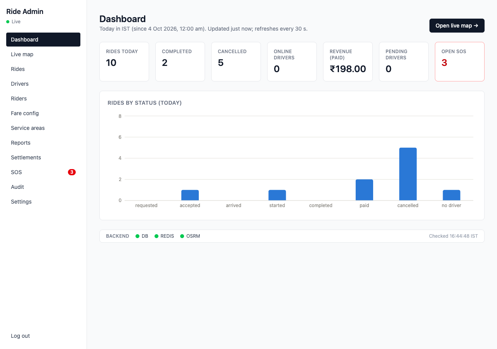
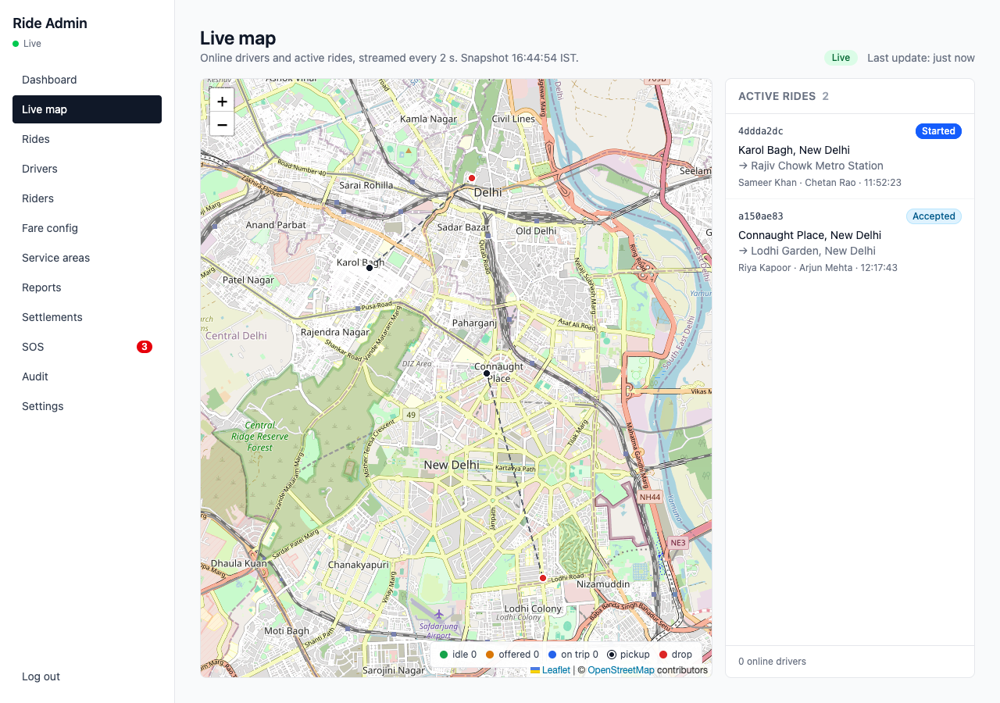
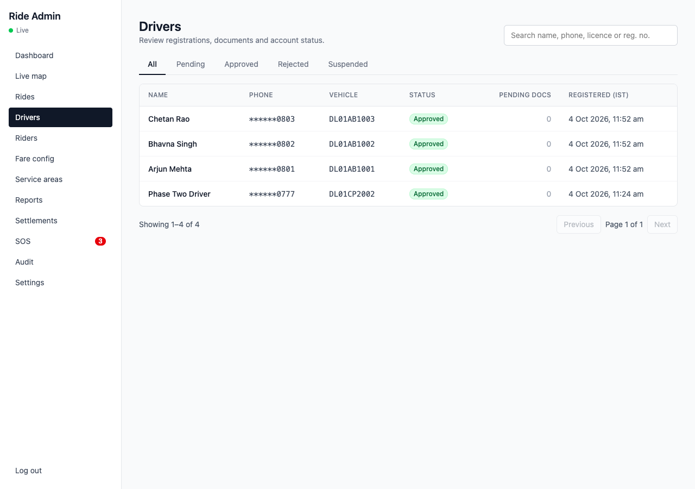
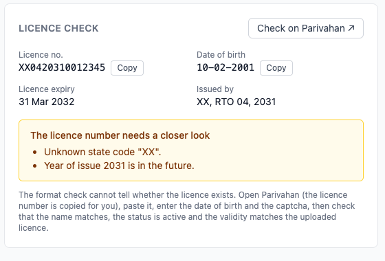
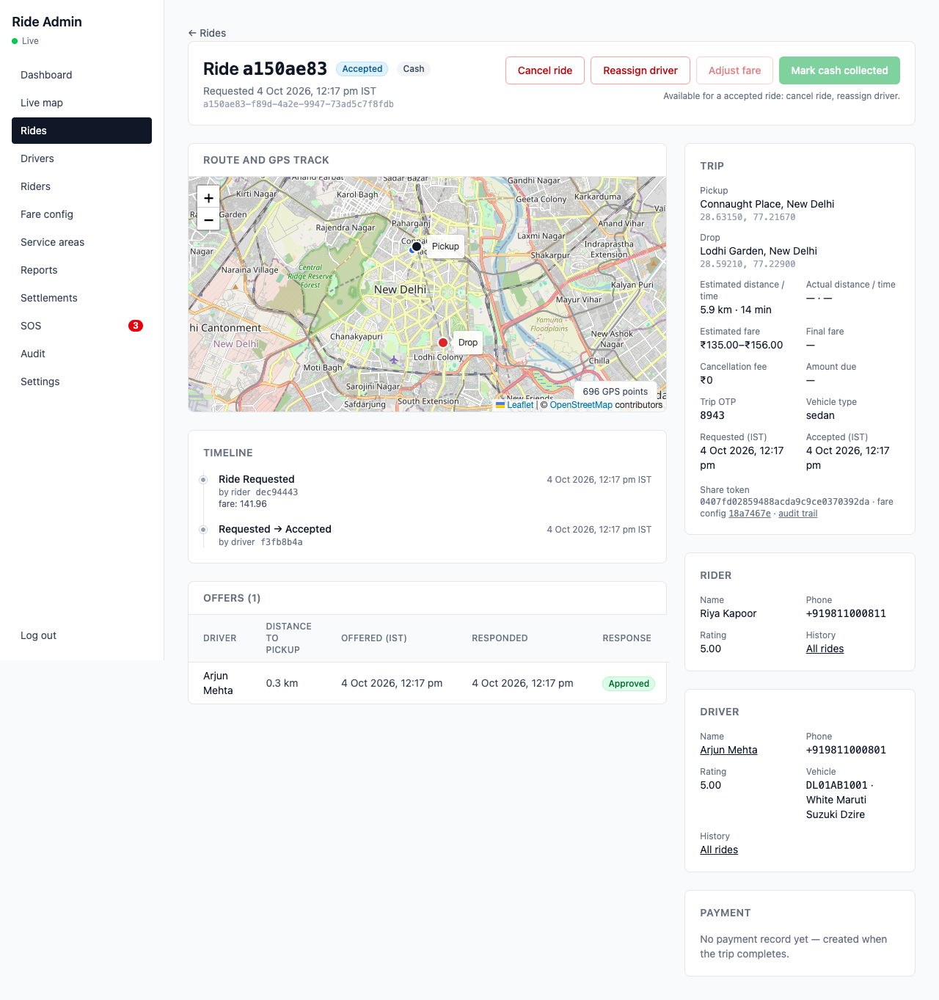
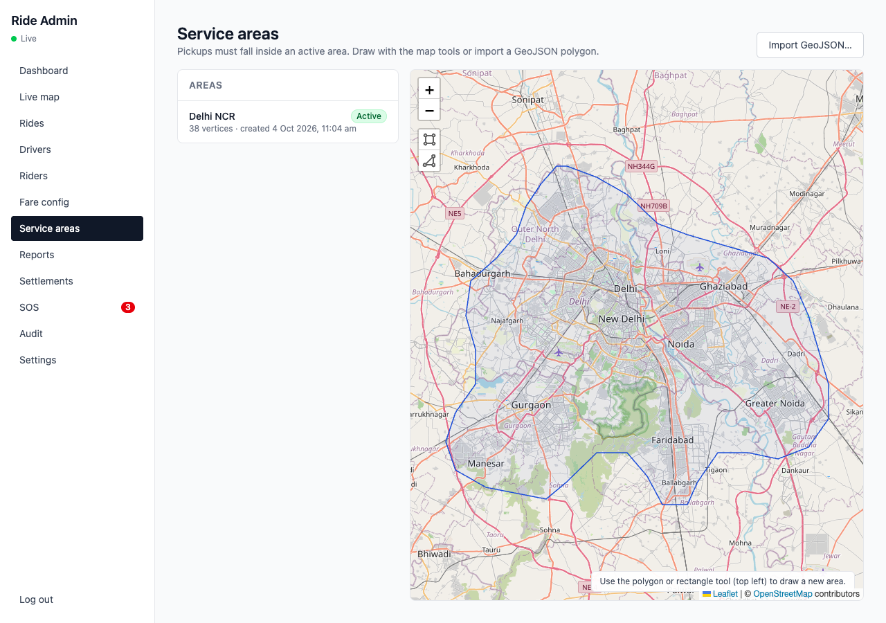
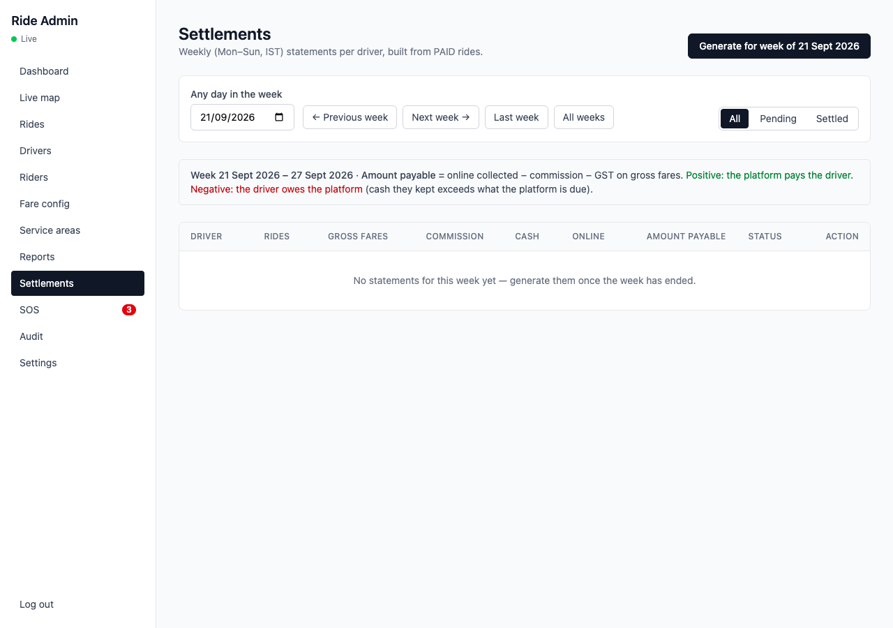
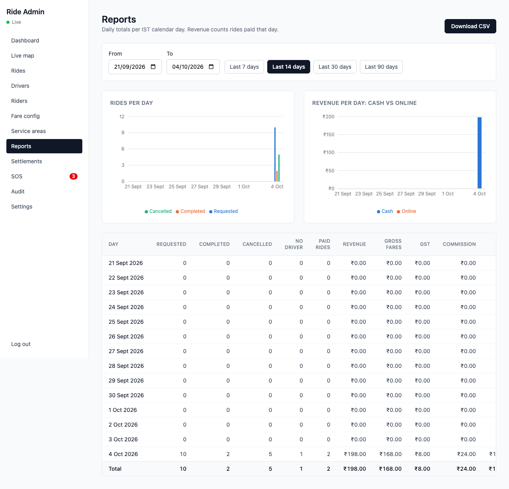

# Admin guide

For the operations team running the Delhi NCR pilot. The admin panel is at `https://admin.<domain>`; sign in with your admin email and password. Every action you take is recorded in the audit log, and anything that affects a driver or rider asks for a reason first.

Screenshots below were taken from the local development stack with sample data.

## Daily routine

1. **Dashboard** — today's rides by status, completed and cancelled counts, drivers online, revenue, pending driver approvals and open SOS alerts. The tiles refresh every 30 seconds.
2. **SOS** — anything open here comes first. Call the rider or driver (numbers are shown), check the position on the map link, then **Acknowledge**.
3. **Drivers → Pending** — review new registrations (see below).
4. **Live map** — a glance at where drivers are and which rides are moving (drivers coloured green = free, amber = looking at one or more ride requests, blue = on a trip).

5. **Rides** — look at anything stuck in `REQUESTED` for more than two minutes or `COMPLETED` for more than ten (payment not collected).

## Approving a driver

1. Open **Drivers**, filter **Pending**, open the driver.
2. **Check the licence is real.** The *Licence check* card shows the licence number, the driver's date of birth and an automatic format check:
   - green "standard format" means the number is laid out correctly (state, RTO, year of issue, 7 digits); it does **not** prove the licence exists;
   - an amber box lists what looks wrong (unknown state code, year in the future, issued before the driver was 16, non-standard layout). Such drivers also carry a *Check licence* badge in the drivers list. Older licences can have a different layout, so treat it as a reason to look closer, not to reject.

   Then click **Check on Parivahan**. The licence number is copied for you; paste it on Parivahan's *Know Your Driving Licence Status* page, enter the date of birth (shown as DD-MM-YYYY, with its own Copy button) and the captcha. Approve the licence only if Parivahan finds it, the status is active, and the name and validity match the uploaded photo.

   
3. Check the rest of the profile and the vehicle (registration, make, model, colour, fuel).
4. Review each document. Click the preview to open the file. **Approve** it, or **Reject** with a note the driver will see (for example "Photo is blurry — upload again"). Expired documents are marked in red; a driver cannot go online with an expired mandatory document even after approval.
5. When all six mandatory documents (driving licence, RC, insurance, permit, ID proof, selfie) are approved, **Approve** the driver. The app updates within seconds and the driver can go online.
6. **Reject** the driver (with a reason) to send them back to registration; **Suspend** (with a reason) to stop an approved driver from going online; **Reinstate** to lift a suspension.

Drivers are **suspended automatically** after three cancellations in a day. You will see an alert on the live map; reinstate from the driver page once you have spoken to them.

## Rides

**Rides** lists everything with filters for status, date range, driver and rider. Open a ride for the timeline (every status change with who did it), the GPS track on a map, the offers made during matching (who was offered, who timed out), and the payment.

Actions, each with a confirmation and a reason:

| Action | When | Effect |
|---|---|---|
| Cancel | before completion | Ride is cancelled with no fee to the rider; the driver is freed |
| Reassign | driver accepted or arrived | Pick an online, idle driver; both drivers' apps update; the rider sees the new car |
| Adjust fare | completed, paid or cancelled after start | Changes the fare; an unpaid online payment picks up the new amount |
| Mark cash | completed | Records a cash payment and closes the ride (use when the driver's app could not) |

A ride cancelled by the rider after the free window carries a cancellation fee; it is collected automatically on that rider's next completed trip and appears as a separate line on their receipt.

**Calls.** Rider and driver call each other through the Aavagaman number, never directly, so neither sees the other's phone. The ride detail's **Calls** card lists every call made during the trip: who started it, the outcome (completed, no answer, busy, failed) and the talk time once the telephony provider reports it. Only admins see real phone numbers, on the Rider and Driver cards.

## Riders

Search by name, phone or email. **Block** (with a reason) signs the rider out everywhere and refuses new logins; **Unblock** restores access. Blocked riders keep their ride history.

## Fare configuration

**Fare config** has one tab per vehicle class (Bike, Auto, Mini, Sedan). Each class has its own tariff versions, and the page shows every version of the selected class; the current one is marked. To change prices, create a **new version** rather than editing: fill in base fare, per km, per minute, minimum fare, cancellation fee, night multiplier (23:00–05:00 IST, only when enabled), commission and GST. The preview calculator on the form shows the estimate range for a sample distance and duration before you save. The new tariff applies to estimates from its effective time onwards; rides already requested keep the tariff they were quoted with.

## Service areas

The service area decides where pickups are allowed. Draw or edit polygons on the map, or import a GeoJSON file, then save. Deactivating an area stops new pickups there immediately; drop-offs outside the area are always allowed and simply flagged in the rider app.

## Payments and settlements

Riders pay cash to the driver or online through Razorpay. Online payments show as **paid** once Razorpay confirms them; if a rider's payment fails, the driver can collect cash instead.

Every Monday morning the system prepares one **settlement** per driver for the previous Monday–Sunday:

- gross fares, commission, GST, cash collected by the driver, online payments collected by the platform;
- **amount payable**: positive means the platform pays the driver (they collected little cash), negative means the driver owes the platform (they collected mostly cash).

After paying or collecting, open the row and **Mark settled** with the bank reference. You can also **Generate** statements for an earlier week on demand; a week can only be generated once it has ended, and a settled statement is never recalculated.

## Reports

**Reports** shows rides, revenue, commission and the cash/online split per day for any date range (IST days). **Download CSV** opens in Excel or Google Sheets.

## Audit log

Every admin action — approvals, rejections, suspensions, blocks, cancellations, reassignments, fare adjustments, settlements, SOS acknowledgements, tariff and service-area changes — is listed with who did it, when, and the before/after values.

## Alerts you may see

| Alert | Meaning | What to do |
|---|---|---|
| SOS | A rider or driver pressed SOS | Call them; the app has already dialled 112 |
| Driver suspended | Three cancellations today | Speak to the driver; reinstate if appropriate |
| OTP failed | A driver entered the wrong trip OTP three times | Check with the rider; the driver can still cancel the ride |
| Double payment / payment after close | An online payment arrived for a ride already paid | Refund through the Razorpay dashboard |

## Support contacts

Rider and driver support phone and email are shown in the apps' Help screens; update them in the apps' configuration before each release.
